# 📱 Directorio Dolorense

**Manual paso a paso con TDD · Consumo de una API local desde Flutter**

API REST en Node · Cliente HTTP · Estados · Pruebas con `MockClient`

*Desarrollo Móvil Integral · UTNG — Prof. Anastacio Rodríguez García*

## Contenido

1. [Antes de empezar: ¿qué vamos a construir?](#antes-de-empezar-qué-vamos-a-construir)
2. [Ronda 1 · La API local (la cocina)](#ronda-1--la-api-local-la-cocina)
3. [Ronda 2 · El modelo Negocio (Dart puro)](#ronda-2--el-modelo-negocio-dart-puro)
4. [Ronda 3 · El cliente HTTP con MockClient](#ronda-3--el-cliente-http-con-mockclient)
5. [Ronda 4 · Conectar app y API de verdad](#ronda-4--conectar-app-y-api-de-verdad)
6. [Ronda 5 · El ViewModel y los 5 estados](#ronda-5--el-viewmodel-y-los-5-estados)
7. [Ronda 6 · La pantalla y la prueba final](#ronda-6--la-pantalla-y-la-prueba-final)
8. [Cierre · Lo que lograste](#cierre--lo-que-lograste)

## Antes de empezar: ¿qué vamos a construir?

Piensa en un restaurante. Tú (la app) te sientas a la mesa, el mesero (el cliente HTTP) lleva tu pedido a la cocina (la API) y regresa con tu platillo (los datos en JSON). Tú nunca entras a la cocina: solo pides con un formato que el mesero entiende.

### El proyecto

Un directorio de negocios de Dolores Hidalgo. Una API local (corriendo en TU computadora) guarda la lista de negocios; la app Flutter la consulta, agrega, marca favoritos y elimina. Todo funciona en tu red Wi-Fi sin pagar servidores.

### Lo que aprenderás

- Qué es una API REST, JSON y los verbos GET, POST, PUT y DELETE.
- Crear una API real con Node en un solo archivo y probarla con `curl`.
- Escribir un cliente HTTP en Dart probado con `MockClient` (sin red, sin servidor).
- Por qué el emulador Android usa `10.0.2.2` y cómo conectar un celular real.
- Manejar los 5 estados de una pantalla: inicial, cargando, listo, vacío y error.

### Requisitos

- Flutter instalado (`flutter doctor` sin errores graves).
- Node.js 18 o superior (`node --version`).
- Computadora y celular en la misma red Wi-Fi (para la prueba en dispositivo real).

### Mapa del proyecto

```text
directorio_dolores/
  api/
    server.js            <- la "cocina": API en Node
  app/
    lib/
      dominio/           <- Negocio y excepciones (Dart puro)
      datos/             <- cliente HTTP y configuración de URL
      presentacion/      <- ViewModel y pantalla
      main.dart
    test/
      negocio_test.dart  negocios_api_test.dart  viewmodel_test.dart
```

### El ciclo TDD de siempre

#### 🔴 ROJO: escribe la prueba (debe FALLAR)

Escribes la prueba de lo que debería pasar; falla.

#### 🟢 VERDE: el código mínimo para pasar

Escribes el código mínimo para que pase.

#### 🔵 REFACTOR: ordena sin romper nada

Ordenas sin romper nada.

> **💡 Dato curioso / ejemplo**
>
> Probar contra internet real es como ensayar una obra con el público dentro: si falla el Wi-Fi, falla tu prueba aunque tu código esté perfecto. Con `MockClient` simulamos al servidor: respuestas exactas, cero red, milisegundos.

## Ronda 1 · La API local (la cocina)

### ¿Qué es una API REST?

Es un servidor que responde a direcciones (URLs) con datos. REST organiza todo en "recursos" (aquí: negocios) y usa verbos HTTP para decir qué quieres hacer:

- `GET /negocios` → "dame la lista" (leer).
- `POST /negocios` → "agrega este nuevo" (crear).
- `PUT /negocios/3` → "reemplaza el negocio 3" (actualizar).
- `DELETE /negocios/3` → "borra el negocio 3" (eliminar).

Los datos viajan en JSON, un texto con llaves y comillas que tanto Node como Dart entienden: `{"id": 1, "nombre": "Nieves de la Plaza"}`.

### Los códigos de respuesta

Cada respuesta trae un número que dice cómo salió todo. Son como los semáforos del servidor:

- 200 OK · 201 Creado · 204 Sin contenido (borrado exitoso).
- 400 Datos inválidos (tú te equivocaste) · 404 No existe.
- 500 Error del servidor (la cocina se incendió).

> **💡 Dato curioso / ejemplo**
>
> El famoso "Error 404" nació en el CERN: según la leyenda, en la oficina 404 estaban los archivos de la web primitiva. Hoy significa "no encuentro lo que pides".

### Paso 1.1 · Crear la carpeta y el archivo

```bash
mkdir directorio_dolores
cd directorio_dolores
mkdir api
cd api
```

Crea el archivo `server.js` con este contenido. No necesita instalar nada: usa solo el módulo http que viene con Node.

**📄 `api/server.js`**

```javascript
// API local del Directorio de Negocios de Dolores Hidalgo.
// Sin dependencias: solo el módulo http de Node.   Uso: node server.js
const http = require('http');

let siguienteId = 6;
const negocios = [
  { id: 1, nombre: 'Nieves de la Plaza', categoria: 'Nevería', telefono: '418-100-0001', favorito: true },
  { id: 2, nombre: 'Talavera La Esperanza', categoria: 'Artesanías', telefono: '418-100-0002', favorito: false },
  { id: 3, nombre: 'Tacos Don Chema', categoria: 'Comida', telefono: '418-100-0003', favorito: false },
  { id: 4, nombre: 'Dulces Cajeta Real', categoria: 'Dulcería', telefono: '418-100-0004', favorito: true },
  { id: 5, nombre: 'Papelería El Cura', categoria: 'Papelería', telefono: '418-100-0005', favorito: false },
];

function responder(res, status, datos) {
  res.writeHead(status, {
    'Content-Type': 'application/json; charset=utf-8',
    'Access-Control-Allow-Origin': '*',
    'Access-Control-Allow-Methods': 'GET,POST,PUT,DELETE,OPTIONS',
    'Access-Control-Allow-Headers': 'Content-Type',
  });
  res.end(datos === undefined ? '' : JSON.stringify(datos));
}

function leerCuerpo(req) {
  return new Promise((ok, fallo) => {
    let texto = '';
    req.on('data', (t) => (texto += t));
    req.on('end', () => {
      try { ok(texto ? JSON.parse(texto) : {}); } catch (e) { fallo(e); }
    });
  });
}

const servidor = http.createServer(async (req, res) => {
  const url = new URL(req.url, 'http://localhost');
  const partes = url.pathname.split('/').filter(Boolean); // ['negocios', '3']
  console.log(new Date().toLocaleTimeString(), req.method, url.pathname);

  if (req.method === 'OPTIONS') return responder(res, 204);
  if (url.pathname === '/salud') return responder(res, 200, { ok: true });
  if (partes[0] !== 'negocios') return responder(res, 404, { error: 'Ruta no encontrada' });

  const id = partes[1] ? Number(partes[1]) : null;
  try {
    if (req.method === 'GET' && id === null) {
      const q = (url.searchParams.get('q') || '').toLowerCase();
      return responder(res, 200, negocios.filter((n) => n.nombre.toLowerCase().includes(q)));
    }
    if (req.method === 'GET') {
      const n = negocios.find((x) => x.id === id);
      return n ? responder(res, 200, n) : responder(res, 404, { error: 'No existe' });
    }
    if (req.method === 'POST') {
      const d = await leerCuerpo(req);
      if (!d.nombre || !d.categoria) return responder(res, 400, { error: 'nombre y categoria son obligatorios' });
      const nuevo = { id: siguienteId++, nombre: d.nombre, categoria: d.categoria, telefono: d.telefono || '', favorito: !!d.favorito };
      negocios.push(nuevo);
      return responder(res, 201, nuevo);
    }
    if (req.method === 'PUT') {
      const i = negocios.findIndex((x) => x.id === id);
      if (i < 0) return responder(res, 404, { error: 'No existe' });
      const d = await leerCuerpo(req);
      negocios[i] = { ...negocios[i], ...d, id };
      return responder(res, 200, negocios[i]);
    }
    if (req.method === 'DELETE') {
      const i = negocios.findIndex((x) => x.id === id);
      if (i < 0) return responder(res, 404, { error: 'No existe' });
      negocios.splice(i, 1);
      return responder(res, 204);
    }
    return responder(res, 405, { error: 'Método no permitido' });
  } catch (e) {
    return responder(res, 400, { error: 'JSON inválido' });
  }
});

const PUERTO = process.env.PORT || 3000;
// 0.0.0.0 permite que el celular (misma red Wi-Fi) llegue a tu computadora.
servidor.listen(PUERTO, '0.0.0.0', () =>
  console.log(`API lista en http://localhost:${PUERTO}/negocios`));
```

### Lectura guiada del servidor

1. `negocios` es una lista en memoria: al apagar el servidor se reinicia (suficiente para aprender).
2. `responder()` siempre manda JSON y las cabeceras CORS, que permiten consultar la API también desde un navegador.
3. Cada `if` revisa método y ruta: GET sin id lista, GET con id busca uno, POST crea, PUT actualiza, DELETE borra.
4. Se valida: sin nombre o categoría, responde 400 en lugar de guardar basura.
5. `listen(PUERTO, "0.0.0.0")` escucha en TODAS las interfaces de red; con `localhost` el celular no podría entrar.

### Paso 1.2 · Encenderla y probarla

```bash
node server.js
```

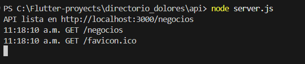

Debes ver: API lista en `http://localhost:3000/negocios`. Deja esa terminal abierta (es tu servidor) y abre OTRA terminal para probar:

```bash
curl localhost:3000/salud
curl localhost:3000/negocios
curl -X POST localhost:3000/negocios -H "Content-Type: application/json" -d '{"nombre":"Mi tienda","categoria":"Abarrotes"}'
curl -X DELETE localhost:3000/negocios/6
```

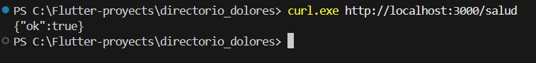

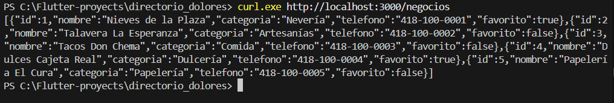

También puedes abrir `http://localhost:3000/negocios` en el navegador: verás el JSON. La terminal del servidor imprime cada petición que llega; es tu "cámara de seguridad".

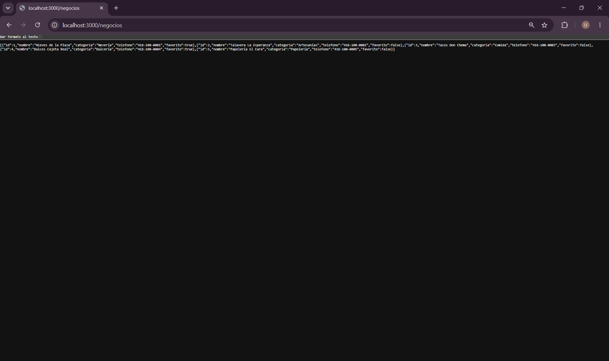

> **⚠️ Cuidado**
>
> En Windows PowerShell, `curl` es un alias distinto. Usa `curl.exe` o prueba con el navegador y con Postman/Thunder Client.

> **🏆 RETO PARA TI**
>
> Con el servidor encendido, intenta `GET /negocios/99` y POST sin categoría. ¿Qué códigos recibes (usa `curl -i` para verlos)? ¿Coinciden con la tabla de arriba?

> **🏅 INSIGNIA DESBLOQUEADA: Dueño de la cocina**

## Ronda 2 · El modelo Negocio (Dart puro)

### Paso 2.1 · Crear el proyecto Flutter

```bash
cd ..
flutter create app --project-name directorio_dolores
cd app
mkdir lib/dominio lib/datos lib/presentacion
```

Reemplaza `pubspec.yaml` por el siguiente (agrega el paquete http) y borra `test/widget_test.dart`, que ya no sirve:

**📄 `app/pubspec.yaml`**

```yaml
name: directorio_dolores
description: Directorio de negocios que consume una API local.
publish_to: none
version: 1.0.0

environment:
  sdk: ">=3.0.0 <4.0.0"

dependencies:
  flutter:
    sdk: flutter
  http: ^1.2.0

dev_dependencies:
  flutter_test:
    sdk: flutter
  flutter_lints: ^3.0.0

flutter:
  uses-material-design: true
```

```bash
flutter pub get
```

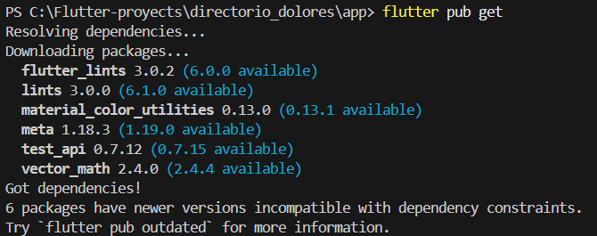

### El problema: traducir entre dos idiomas

La API habla JSON (texto). Dart habla objetos. Necesitamos un traductor en las dos direcciones: `desdeJson` (texto → objeto) y `aJson` (objeto → texto). Si el traductor se equivoca, toda la app muestra datos incorrectos, por eso lo probamos primero.

### Ciclo 2.2 · Leer todos los campos

#### 🔴 ROJO: escribe la prueba (debe FALLAR)

Crea `test/negocio_test.dart`:

**📄 `app/test/negocio_test.dart`**

```dart
import 'package:flutter_test/flutter_test.dart';
import 'package:directorio_dolores/dominio/negocio.dart';

void main() {
  test('desdeJson lee todos los campos', () {
    final n = Negocio.desdeJson({
      'id': 1, 'nombre': 'Nieves de la Plaza', 'categoria': 'Nevería',
      'telefono': '418-100-0001', 'favorito': true,
    });
    expect(n.id, 1);
    expect(n.nombre, 'Nieves de la Plaza');
    expect(n.favorito, true);
  });

  test('campos opcionales ausentes usan valores por omisión', () {
    final n = Negocio.desdeJson({'id': 2, 'nombre': 'X', 'categoria': 'Y'});
    expect(n.telefono, '');
    expect(n.favorito, false);
  });

  test('aJson no manda id cuando es nuevo', () {
    const n = Negocio(nombre: 'X', categoria: 'Y');
    expect(n.aJson().containsKey('id'), false);
  });

  test('copiarCon cambia solo el favorito', () {
    const n = Negocio(id: 3, nombre: 'X', categoria: 'Y');
    final f = n.copiarCon(favorito: true);
    expect(f.favorito, true);
    expect(f.nombre, 'X');
    expect(f.id, 3);
  });
}
```

```bash
flutter test
```

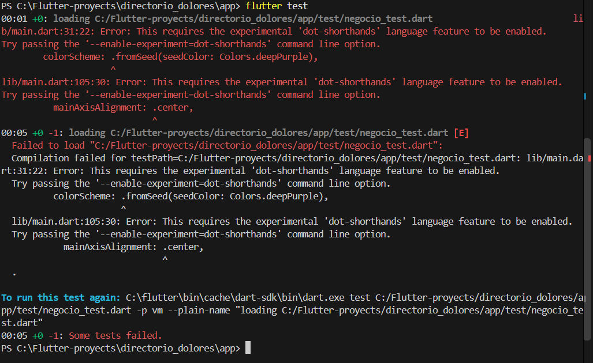

Falla porque `dominio/negocio.dart` no existe. ¡Perfecto!

#### 🟢 VERDE: el código mínimo para pasar

Crea el modelo:

**📄 `app/lib/dominio/negocio.dart`**

```dart
class Negocio {
  final int? id;
  final String nombre;
  final String categoria;
  final String telefono;
  final bool favorito;

  const Negocio({
    this.id,
    required this.nombre,
    required this.categoria,
    this.telefono = '',
    this.favorito = false,
  });

  factory Negocio.desdeJson(Map<String, dynamic> json) => Negocio(
        id: json['id'] as int?,
        nombre: json['nombre'] as String,
        categoria: json['categoria'] as String,
        telefono: (json['telefono'] as String?) ?? '',
        favorito: (json['favorito'] as bool?) ?? false,
      );

  Map<String, dynamic> aJson() => {
        if (id != null) 'id': id,
        'nombre': nombre,
        'categoria': categoria,
        'telefono': telefono,
        'favorito': favorito,
      };

  Negocio copiarCon({bool? favorito}) => Negocio(
        id: id,
        nombre: nombre,
        categoria: categoria,
        telefono: telefono,
        favorito: favorito ?? this.favorito,
      );
}
```

> **💡 Dato curioso / ejemplo**
>
> Fíjate en `(json["telefono"] as String?) ?? ""`. Los servidores reales a veces omiten campos. Si tu app asumiera que SIEMPRE vienen, un solo dato faltante la haría tronar para todos los usuarios. Programar defensivo es como revisar el semáforo aunque tengas verde.

#### 🔵 REFACTOR: ordena sin romper nada

Nota que `aJson` omite el id cuando es nuevo: el servidor es quien lo asigna. Quien crea la cuenta no escoge su número de cliente.

### Paso 2.3 · Excepciones con nombre propio

Crea las tres excepciones que usaremos en la siguiente ronda. Dos errores técnicos muy distintos (se cayó el Wi-Fi vs. el servidor devolvió 500) merecen mensajes distintos para el usuario.

**📄 `app/lib/dominio/excepciones.dart`**

```dart
/// Errores con nombre propio: la pantalla decide qué mensaje mostrar.
class SinConexionException implements Exception {
  @override
  String toString() =>
      'No se pudo conectar con el servidor. ¿Está encendida la API y estás en la misma red?';
}

class ErrorServidorException implements Exception {
  final int codigo;
  ErrorServidorException(this.codigo);
  @override
  String toString() => codigo == 404
      ? 'No se encontró lo que buscabas (404).'
      : codigo == 400
          ? 'El servidor rechazó los datos enviados (400).'
          : 'El servidor respondió con error ($codigo).';
}

class RespuestaInvalidaException implements Exception {
  @override
  String toString() => 'El servidor respondió algo que no entiendo.';
}
```

> **🏅 INSIGNIA DESBLOQUEADA: Traductor JSON**

## Ronda 3 · El cliente HTTP con MockClient

### El mesero y su doble de pruebas

`NegociosApi` recibe un `http.Client` desde afuera (inyección de dependencias). En la app real le damos el cliente verdadero; en las pruebas le damos un `MockClient` que contesta lo que NOSOTROS le programemos. Es como ensayar con un actor que hace de cocinero: controlas exactamente qué respuesta llega.

> **💡 Dato curioso / ejemplo**
>
> Sin `MockClient`, para probar "qué pasa si el servidor devuelve 500" tendrías que romper tu propio servidor a propósito. Con `MockClient` lo logras con una línea.

### Ciclo 3.1 · Listar

#### 🔴 ROJO: escribe la prueba (debe FALLAR)

Crea `test/negocios_api_test.dart` empezando con esta prueba (después agregaremos las demás):

**📄 `app/test/negocios_api_test.dart`** (arranque)

```dart
import 'dart:convert';
import 'dart:io';

import 'package:directorio_dolores/datos/negocios_api.dart';
import 'package:directorio_dolores/dominio/excepciones.dart';
import 'package:directorio_dolores/dominio/negocio.dart';
import 'package:flutter_test/flutter_test.dart';
import 'package:http/http.dart' as http;
import 'package:http/testing.dart';

NegociosApi apiCon(MockClient c) => NegociosApi(c, 'http://prueba');

void main() {
  test('listar convierte el JSON en objetos Negocio', () async {
    final api = apiCon(MockClient((req) async {
      expect(req.method, 'GET');
      expect(req.url.path, '/negocios');
      return http.Response(
          jsonEncode([
            {'id': 1, 'nombre': 'A', 'categoria': 'X'},
            {'id': 2, 'nombre': 'B', 'categoria': 'Y'},
          ]),
          200);
    }));
    final lista = await api.listar();
    expect(lista.length, 2);
    expect(lista.first.nombre, 'A');
  });
}
```

Observa que dentro del `MockClient` también hacemos expect sobre la petición: verificamos que la app pida el método y la ruta correctos, no solo que sepa leer la respuesta.

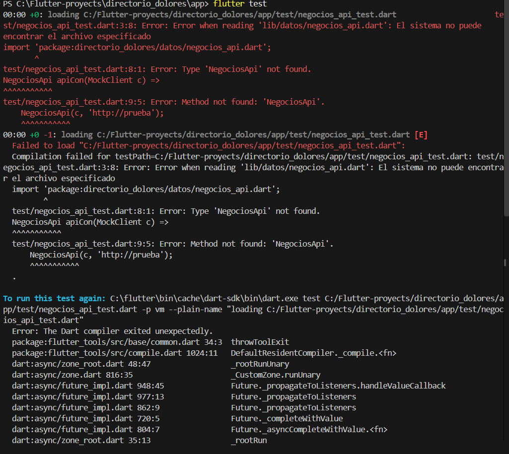

#### 🟢 VERDE: el código mínimo para pasar

Crea el cliente completo. Lo veremos por partes justo después:

**📄 `app/lib/datos/negocios_api.dart`**

```dart
import 'dart:async';
import 'dart:convert';
import 'dart:io';

import 'package:http/http.dart' as http;

import '../dominio/excepciones.dart';
import '../dominio/negocio.dart';

class NegociosApi {
  final http.Client _cliente;
  final String baseUrl;
  final Duration espera;

  NegociosApi(this._cliente, this.baseUrl,
      {this.espera = const Duration(seconds: 5)});

  Uri _uri(String ruta) => Uri.parse('$baseUrl$ruta');
  static const _json = {'Content-Type': 'application/json'};

  Future<List<Negocio>> listar({String busqueda = ''}) async {
    final r = await _ejecutar(() => _cliente
        .get(_uri('/negocios${busqueda.isEmpty ? '' : '?q=${Uri.encodeQueryComponent(busqueda)}'}')));
    try {
      final lista = jsonDecode(r.body) as List;
      return lista
          .map((e) => Negocio.desdeJson(e as Map<String, dynamic>))
          .toList();
    } catch (_) {
      throw RespuestaInvalidaException();
    }
  }

  Future<Negocio> crear(Negocio n) async {
    final r = await _ejecutar(() =>
        _cliente.post(_uri('/negocios'), headers: _json, body: jsonEncode(n.aJson())));
    return _leerUno(r);
  }

  Future<Negocio> actualizar(Negocio n) async {
    final r = await _ejecutar(() => _cliente.put(_uri('/negocios/${n.id}'),
        headers: _json, body: jsonEncode(n.aJson())));
    return _leerUno(r);
  }

  Future<void> eliminar(int id) async {
    await _ejecutar(() => _cliente.delete(_uri('/negocios/$id')));
  }

  Negocio _leerUno(http.Response r) {
    try {
      return Negocio.desdeJson(jsonDecode(r.body) as Map<String, dynamic>);
    } catch (_) {
      throw RespuestaInvalidaException();
    }
  }

  /// Un solo lugar donde se traducen los fallos técnicos a errores del negocio.
  Future<http.Response> _ejecutar(Future<http.Response> Function() peticion) async {
    http.Response r;
    try {
      r = await peticion().timeout(espera);
    } on SocketException {
      throw SinConexionException();
    } on TimeoutException {
      throw SinConexionException();
    } on http.ClientException {
      throw SinConexionException();
    }
    if (r.statusCode < 200 || r.statusCode >= 300) {
      throw ErrorServidorException(r.statusCode);
    }
    return r;
  }
}
```

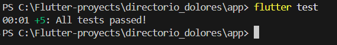

### Lectura guiada: el método `_ejecutar`

Todas las peticiones pasan por UN solo lugar, así traducimos los fallos técnicos una sola vez:

1. `peticion().timeout(espera)`: si el servidor no contesta en 5 segundos, cortamos. Sin esto, la rueda de carga giraría para siempre.
2. `SocketException`, `TimeoutException` y `ClientException` se convierten en `SinConexionException` (para el usuario todo es "no hay conexión").
3. Si llega respuesta pero el código no es 2xx, lanzamos `ErrorServidorException` con el número.
4. Si todo sale bien, devolvemos la respuesta y cada método la convierte a objetos.

> **⚠️ Cuidado**
>
> Un 404 o 500 NO lanza excepción por sí solo en el paquete http: la petición "salió bien" aunque el servidor diga que falló. Si no revisas `statusCode`, tu app tratará un error como si fueran datos.

### Ciclo 3.2 · Los casos de falla

#### 🔴 ROJO: escribe la prueba (debe FALLAR)

Agrega estas pruebas dentro de `main()`. Cada una corresponde a una situación real:

```dart
  test('status 500 lanza ErrorServidorException con el código', () async {
    final api = apiCon(MockClient((_) async => http.Response('boom', 500)));
    expect(
        api.listar(),
        throwsA(isA<ErrorServidorException>()
            .having((e) => e.codigo, 'codigo', 500)));
  });

  test('sin red lanza SinConexionException', () {
    final api = apiCon(MockClient((_) async => throw const SocketException('x')));
    expect(api.listar(), throwsA(isA<SinConexionException>()));
  });

  test('timeout se trata como sin conexión', () {
    final api = NegociosApi(
      MockClient((_) async {
        await Future.delayed(const Duration(milliseconds: 200));
        return http.Response('[]', 200);
      }),
      'http://prueba',
      espera: const Duration(milliseconds: 20),
    );
    expect(api.listar(), throwsA(isA<SinConexionException>()));
  });

  test('JSON roto lanza RespuestaInvalidaException', () {
    final api = apiCon(MockClient((_) async => http.Response('<html>', 200)));
    expect(api.listar(), throwsA(isA<RespuestaInvalidaException>()));
  });
```

#### 🟢 VERDE: el código mínimo para pasar

Ya pasan con el código de arriba. Mira el truco del timeout: el parámetro espera permite que en la prueba sea de 20 milisegundos y en la app de 5 segundos. Diseñar para probar mejora el diseño.

> **💡 Dato curioso / ejemplo**
>
> El JSON roto con `<html>` es un caso muy real: cuando el Wi-Fi de un café te redirige a una página de login, tu app recibe HTML en lugar de JSON con código 200. Sin esta prueba, tu app se cerraría con un error críptico.

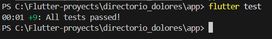

### Ciclo 3.3 · Crear, buscar y eliminar

#### 🔴 ROJO: escribe la prueba (debe FALLAR)

Más pruebas:

```dart
  test('listar con búsqueda manda el parámetro q codificado', () async {
    final api = apiCon(MockClient((req) async {
      expect(req.url.queryParameters['q'], 'nieve limón');
      return http.Response('[]', 200);
    }));
    await api.listar(busqueda: 'nieve limón');
  });

  test('crear envía JSON con Content-Type correcto', () async {
    final api = apiCon(MockClient((req) async {
      expect(req.method, 'POST');
      expect(req.headers['Content-Type'], contains('application/json'));
      final cuerpo = jsonDecode(req.body) as Map<String, dynamic>;
      expect(cuerpo['nombre'], 'Nuevo');
      return http.Response(jsonEncode({...cuerpo, 'id': 9}), 201);
    }));
    final creado = await api.crear(const Negocio(nombre: 'Nuevo', categoria: 'Z'));
    expect(creado.id, 9);
  });

  test('eliminar usa DELETE al id correcto', () async {
    final api = apiCon(MockClient((req) async {
      expect(req.method, 'DELETE');
      expect(req.url.path, '/negocios/4');
      return http.Response('', 204);
    }));
    await api.eliminar(4);
  });
```

#### 🟢 VERDE: el código mínimo para pasar

Todo ya está implementado. Ejecuta:

```bash
flutter test
```

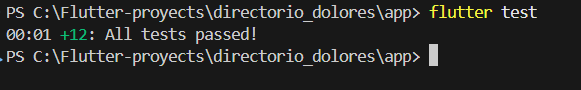

> **💡 Dato curioso / ejemplo**
>
> `Uri.encodeQueryComponent` convierte "nieve limón" en "nieve+lim%C3%B3n". Sin eso, una tilde o un espacio rompería la dirección. Es como escribir en el sobre la dirección en un código que el cartero siempre entiende.

> **⚠️ Cuidado**
>
> Si olvidas el header `Content-Type: application/json` en un POST, muchos servidores no entienden el cuerpo. Es el error número uno de "mi POST no funciona".

> **🏆 RETO PARA TI**
>
> Agrega una prueba para `actualizar()` (PUT): verifica que use el método PUT, la ruta `/negocios/ID` y que el body incluya el campo favorito.

> **🏅 INSIGNIA DESBLOQUEADA: Mesero impecable**

## Ronda 4 · Conectar app y API de verdad

### El enredo clásico: `localhost` no es lo que crees

`localhost` significa "esta misma máquina". Si la app corre DENTRO del emulador Android, `localhost` es el emulador, no tu computadora. Por eso necesitamos direcciones distintas según dónde corre la app:

- Emulador Android → `http://10.0.2.2:3000` (dirección especial que apunta a tu computadora).
- Simulador iOS o escritorio → `http://localhost:3000`.
- Celular real → `http://IP-DE-TU-PC:3000` (ejemplo: `192.168.1.50`), en la misma red Wi-Fi.

> **💡 Dato curioso / ejemplo**
>
> Es como pedirle a alguien "ven a mi casa": si le dices "a mi casa", no sabe cuál. Hay que dar la dirección completa según desde dónde llega.

### Paso 4.1 · Configuración de la URL

**📄 `app/lib/datos/config_api.dart`**

```dart
import 'dart:io' show Platform;

/// Dirección de la API según dónde corre la app.
///  - Emulador Android: 10.0.2.2 es "la computadora anfitriona".
///  - Simulador iOS / escritorio: localhost.
///  - Celular real: pasa la IP de tu PC:
///      flutter run --dart-define=API_URL=http://192.168.1.50:3000
String urlBaseApi() {
  const manual = String.fromEnvironment('API_URL');
  if (manual.isNotEmpty) return manual;
  if (Platform.isAndroid) return 'http://10.0.2.2:3000';
  return 'http://localhost:3000';
}
```

Con `--dart-define` puedes cambiar la dirección SIN tocar el código: ideal cuando cambias de red o de computadora.

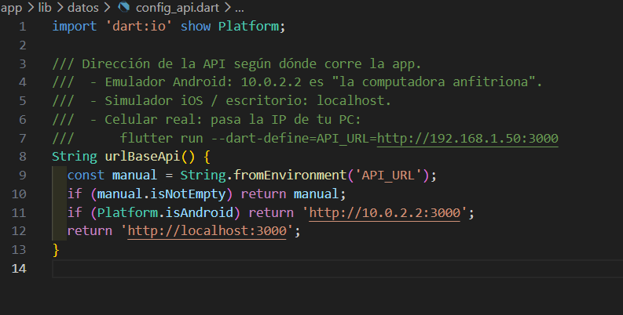

### Paso 4.2 · Permitir tráfico HTTP en Android

Desde Android 9, las apps bloquean por seguridad las direcciones http:// (sin candado). Para desarrollo local debes permitirlas. Abre `android/app/src/main/AndroidManifest.xml` y agrega el atributo `usesCleartextTraffic` a la etiqueta application, y el permiso de internet arriba:

**📄 `app/android/app/src/main/AndroidManifest.xml`**

```xml
<manifest xmlns:android="http://schemas.android.com/apk/res/android">
    <uses-permission android:name="android.permission.INTERNET"/>
    <application
        android:usesCleartextTraffic="true"
        android:label="directorio_dolores"
        ...>
```

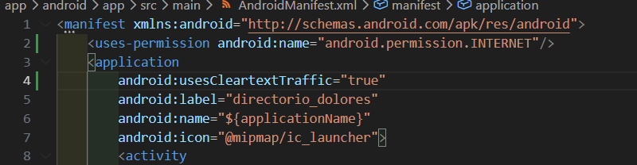

> **⚠️ Cuidado**
>
> `usesCleartextTraffic="true"` es SOLO para desarrollo. Una app publicada debe hablar con HTTPS.

### Paso 4.3 · iOS (si usas Mac)

En `ios/Runner/Info.plist` agrega la excepción de seguridad de transporte para desarrollo local:

```xml
<key>NSAppTransportSecurity</key>
<dict>
  <key>NSAllowsLocalNetworking</key>
  <true/>
</dict>
```

### Paso 4.4 · Encontrar la IP de tu computadora (celular real)

```bash
# Windows
ipconfig
# Mac / Linux
ifconfig   (o: ip addr)
```

Busca la dirección IPv4 de tu red Wi-Fi (empieza con 192.168... o 10.0...). Antes de usar la app, comprueba desde el navegador del CELULAR que `http://TU-IP:3000/salud` muestre `{"ok":true}`. Si el navegador del celular no la ve, la app tampoco la verá.


<p align="center"></p>

### Tabla de solución de problemas

| Síntoma | Causa y solución |
|---|---|
| `Connection refused` en emulador | usas `localhost` en lugar de `10.0.2.2`. |
| Funciona en emulador pero no en celular | PC y celular en redes distintas, o el firewall de la PC bloquea el puerto 3000. |
| `Cleartext HTTP traffic not permitted` | falta `usesCleartextTraffic` en el manifiesto. |
| Timeout largo | el servidor no está encendido o la IP cambió (el router la reasigna). |
| Lista vacía pero sin error | reiniciaste el servidor: los datos viven en memoria. |

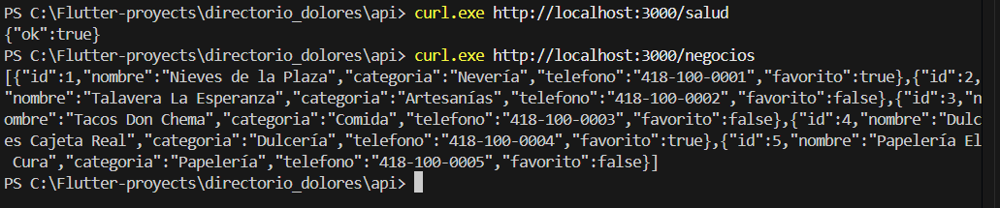

> **🏅 INSIGNIA DESBLOQUEADA: Navegante de redes**

## Ronda 5 · El ViewModel y los 5 estados

### Una pantalla honesta nunca se queda en blanco

Cuando pides datos a una red, la pantalla pasa por varias situaciones. Si solo programas el caso feliz, el usuario ve una pantalla vacía y piensa que la app está rota. Modelamos cinco estados:

- inicial: aún no se pidió nada.
- cargando: esperando respuesta (rueda de carga).
- listo: llegaron datos (se muestra la lista).
- vacio: llegó bien pero no hay nada (mensaje amable).
- error: algo falló (mensaje claro y botón Reintentar).

> **💡 Dato curioso / ejemplo**
>
> Es como el estatus de un pedido en una app de entrega: "preparando", "en camino", "entregado", "sin repartidores disponibles". Cada estado dice algo útil; nunca "pantalla blanca".

### Ciclo 5.1 · Pruebas de la secuencia de estados

#### 🔴 ROJO: escribe la prueba (debe FALLAR)

Crea `test/viewmodel_test.dart`:

**📄 `app/test/viewmodel_test.dart`**

```dart
import 'dart:convert';

import 'package:directorio_dolores/datos/negocios_api.dart';
import 'package:directorio_dolores/dominio/negocio.dart';
import 'package:directorio_dolores/presentacion/negocios_viewmodel.dart';
import 'package:flutter_test/flutter_test.dart';
import 'package:http/http.dart' as http;
import 'package:http/testing.dart';

NegociosViewModel vmCon(Future<http.Response> Function(http.Request) h) =>
    NegociosViewModel(NegociosApi(MockClient(h), 'http://prueba'));

void main() {
  test('cargar con datos termina en listo', () async {
    final vm = vmCon((_) async => http.Response(
        jsonEncode([{'id': 1, 'nombre': 'A', 'categoria': 'X'}]), 200));
    final estados = <Estado>[];
    vm.addListener(() => estados.add(vm.estado));
    await vm.cargar();
    expect(estados, [Estado.cargando, Estado.listo]);
    expect(vm.negocios.length, 1);
  });

  test('cargar con lista vacía termina en vacio', () async {
    final vm = vmCon((_) async => http.Response('[]', 200));
    await vm.cargar();
    expect(vm.estado, Estado.vacio);
  });

  test('cargar con error de servidor termina en error con mensaje', () async {
    final vm = vmCon((_) async => http.Response('', 500));
    await vm.cargar();
    expect(vm.estado, Estado.error);
    expect(vm.mensajeError, contains('500'));
  });

  test('eliminar quita el negocio de la lista', () async {
    final vm = vmCon((req) async => req.method == 'DELETE'
        ? http.Response('', 204)
        : http.Response(
            jsonEncode([
              {'id': 1, 'nombre': 'A', 'categoria': 'X'},
              {'id': 2, 'nombre': 'B', 'categoria': 'Y'},
            ]),
            200));
    await vm.cargar();
    await vm.eliminar(vm.negocios.first);
    expect(vm.negocios.map((n) => n.id), [2]);
  });

  test('alternarFavorito actualiza con la respuesta del servidor', () async {
    final vm = vmCon((req) async {
      if (req.method == 'PUT') {
        return http.Response(
            jsonEncode({'id': 1, 'nombre': 'A', 'categoria': 'X', 'favorito': true}), 200);
      }
      return http.Response(jsonEncode([{'id': 1, 'nombre': 'A', 'categoria': 'X'}]), 200);
    });
    await vm.cargar();
    await vm.alternarFavorito(vm.negocios.first);
    expect(vm.negocios.first.favorito, true);
  });
}
```

La primera prueba es la más interesante: registra los estados que el ViewModel va anunciando y verifica que sean EXACTAMENTE [cargando, listo]. Así probamos el "viaje", no solo el destino.

#### 🟢 VERDE: el código mínimo para pasar

Crea el ViewModel:

**📄 `app/lib/presentacion/negocios_viewmodel.dart`**

```dart
import 'package:flutter/foundation.dart';
import '../datos/negocios_api.dart';
import '../dominio/negocio.dart';

enum Estado { inicial, cargando, listo, vacio, error }

class NegociosViewModel extends ChangeNotifier {
  final NegociosApi api;
  Estado estado = Estado.inicial;
  List<Negocio> negocios = [];
  String? mensajeError;

  NegociosViewModel(this.api);

  Future<void> cargar({String busqueda = ''}) async {
    estado = Estado.cargando;
    mensajeError = null;
    notifyListeners();
    try {
      negocios = await api.listar(busqueda: busqueda);
      estado = negocios.isEmpty ? Estado.vacio : Estado.listo;
    } catch (e) {
      mensajeError = e.toString();
      estado = Estado.error;
    }
    notifyListeners();
  }

  Future<void> agregar(Negocio n) async {
    try {
      await api.crear(n);
      await cargar();
    } catch (e) {
      mensajeError = e.toString();
      estado = Estado.error;
      notifyListeners();
    }
  }

  Future<void> eliminar(Negocio n) async {
    try {
      await api.eliminar(n.id!);
      negocios = negocios.where((x) => x.id != n.id).toList();
      estado = negocios.isEmpty ? Estado.vacio : Estado.listo;
    } catch (e) {
      mensajeError = e.toString();
      estado = Estado.error;
    }
    notifyListeners();
  }

  Future<void> alternarFavorito(Negocio n) async {
    try {
      final nuevo = await api.actualizar(n.copiarCon(favorito: !n.favorito));
      negocios = [for (final x in negocios) x.id == nuevo.id ? nuevo : x];
    } catch (e) {
      mensajeError = e.toString();
    }
    notifyListeners();
  }
}
```

> **💡 Dato curioso / ejemplo**
>
> En `eliminar()` quitamos el negocio de la lista local sin volver a pedirla toda al servidor: la pantalla se actualiza al instante. Es una "actualización optimista simplificada": primero el servidor confirma (el await) y luego actualizamos la vista.

> **⚠️ Cuidado**
>
> `catch (e)` atrapa cualquier error y lo convierte en mensaje. Eso evita que la app se cierre, pero en un proyecto real también registrarías el error para poder depurarlo.

```bash
flutter test
```

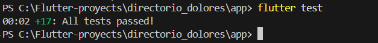

#### 🔵 REFACTOR: ordena sin romper nada

Todas las pruebas (modelo, cliente HTTP, ViewModel) corren sin red, sin emulador y en pocos segundos. ¡Ese es el poder del TDD con dobles de prueba!

> **🏆 RETO PARA TI**
>
> Agrega una prueba: si `agregar()` falla por un 400, el estado debe ser error y el mensaje debe contener "400".

> **🏅 INSIGNIA DESBLOQUEADA: Director de estados**

## Ronda 6 · La pantalla y la prueba final

### Paso 6.1 · La pantalla

La pantalla solo dibuja según el estado del ViewModel. El switch de Dart garantiza que cubrimos los cinco casos: si olvidas uno, el compilador te avisa.

**📄 `app/lib/presentacion/pantalla_negocios.dart`**

```dart
import 'package:flutter/material.dart';
import '../dominio/negocio.dart';
import 'negocios_viewmodel.dart';

class PantallaNegocios extends StatefulWidget {
  final NegociosViewModel vm;
  const PantallaNegocios({super.key, required this.vm});
  @override
  State<PantallaNegocios> createState() => _PantallaNegociosState();
}

class _PantallaNegociosState extends State<PantallaNegocios> {
  @override
  void initState() {
    super.initState();
    widget.vm.cargar();
  }

  Future<void> _nuevo() async {
    final nombre = TextEditingController();
    final categoria = TextEditingController();
    final ok = await showDialog<bool>(
      context: context,
      builder: (_) => AlertDialog(
        title: const Text('Nuevo negocio'),
        content: Column(mainAxisSize: MainAxisSize.min, children: [
          TextField(controller: nombre, decoration: const InputDecoration(labelText: 'Nombre')),
          TextField(controller: categoria, decoration: const InputDecoration(labelText: 'Categoría')),
        ]),
        actions: [
          TextButton(onPressed: () => Navigator.pop(context, false), child: const Text('Cancelar')),
          FilledButton(onPressed: () => Navigator.pop(context, true), child: const Text('Guardar')),
        ],
      ),
    );
    if (ok == true) {
      await widget.vm.agregar(Negocio(nombre: nombre.text, categoria: categoria.text));
    }
  }

  @override
  Widget build(BuildContext context) {
    final vm = widget.vm;
    return AnimatedBuilder(
      animation: vm,
      builder: (_, __) => Scaffold(
        appBar: AppBar(title: const Text('Directorio · Dolores Hidalgo')),
        floatingActionButton:
            FloatingActionButton(onPressed: _nuevo, child: const Icon(Icons.add)),
        body: switch (vm.estado) {
          Estado.inicial || Estado.cargando =>
            const Center(child: CircularProgressIndicator()),
          Estado.error => Center(
              child: Padding(
                padding: const EdgeInsets.all(24),
                child: Column(mainAxisSize: MainAxisSize.min, children: [
                  const Icon(Icons.cloud_off, size: 64),
                  const SizedBox(height: 12),
                  Text(vm.mensajeError ?? 'Error', textAlign: TextAlign.center),
                  const SizedBox(height: 12),
                  FilledButton(onPressed: vm.cargar, child: const Text('Reintentar')),
                ]),
              ),
            ),
          Estado.vacio => const Center(child: Text('Aún no hay negocios. ¡Agrega el primero!')),
          Estado.listo => RefreshIndicator(
              onRefresh: vm.cargar,
              child: ListView(children: [
                for (final n in vm.negocios)
                  Dismissible(
                    key: ValueKey(n.id),
                    background: Container(color: Colors.red),
                    onDismissed: (_) => vm.eliminar(n),
                    child: ListTile(
                      title: Text(n.nombre),
                      subtitle: Text('${n.categoria} · ${n.telefono}'),
                      trailing: IconButton(
                        icon: Icon(n.favorito ? Icons.star : Icons.star_border),
                        onPressed: () => vm.alternarFavorito(n),
                      ),
                    ),
                  ),
              ]),
            ),
        },
      ),
    );
  }
}
```

### Detalles que hacen buena a una pantalla de red

- `RefreshIndicator`: el usuario jala hacia abajo para recargar, como en cualquier app moderna.
- `Dismissible`: deslizar un renglón lo elimina (llama a DELETE en la API).
- Botón Reintentar en el estado de error: el usuario puede recuperarse sin cerrar la app.
- Ícono de nube tachada y mensaje claro: el error explica qué pasó y qué hacer.

### Paso 6.2 · Conectar todo

**📄 `app/lib/main.dart`**

```dart
import 'package:flutter/material.dart';
import 'package:http/http.dart' as http;
import 'datos/config_api.dart';
import 'datos/negocios_api.dart';
import 'presentacion/negocios_viewmodel.dart';
import 'presentacion/pantalla_negocios.dart';

void main() {
  final api = NegociosApi(http.Client(), urlBaseApi()); // composition root
  runApp(MaterialApp(
    title: 'Directorio Dolores',
    theme: ThemeData(colorSchemeSeed: Colors.deepOrange, useMaterial3: true),
    home: PantallaNegocios(vm: NegociosViewModel(api)),
  ));
}
```

### Paso 6.3 · Prueba de fuego (en este orden)

1. Terminal 1: dentro de `api/`, ejecuta `node server.js`.
2. Terminal 2: dentro de `app/`, abre un emulador Android y ejecuta `flutter run`.
3. Verás la lista de negocios. Marca una estrella (PUT), agrega uno con el botón + (POST) y desliza uno para borrarlo (DELETE). Mira cómo la terminal del servidor imprime cada petición.
4. Apaga el servidor (Ctrl+C) y jala para recargar: debe salir el mensaje de falta de conexión con el botón Reintentar.
5. Enciende el servidor otra vez y toca Reintentar: la lista regresa.
6. Para celular real: `flutter run --dart-define=API_URL=http://TU-IP:3000`

> **💡 Dato curioso / ejemplo**
>
> El paso 4 es la verdadera prueba: una app que solo funciona cuando todo sale bien no está terminada. La mayoría de las apps "malas" son simplemente apps que nunca probaron qué pasa sin internet.

> **🏅 INSIGNIA DESBLOQUEADA: Integrador full stack**

<p align="center">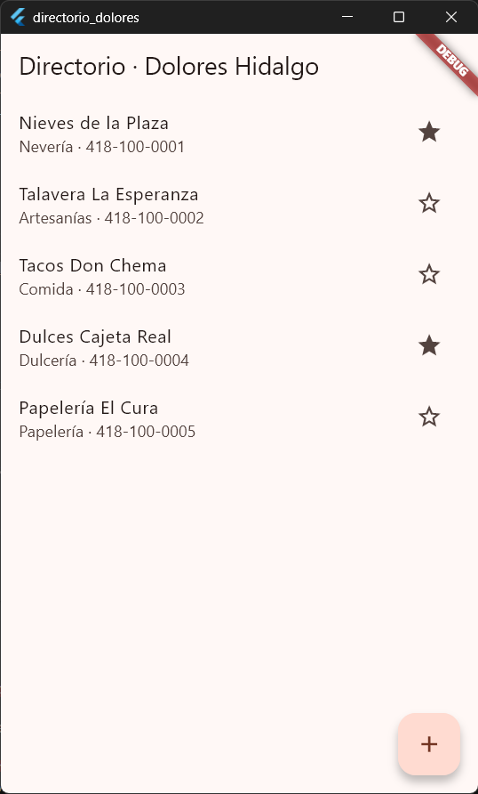</p>

## Cierre · Lo que lograste

### Checklist de calidad

- La URL base no está escrita "a fuego": se configura por plataforma y con `--dart-define`.
- Todos los fallos técnicos se traducen a excepciones con mensajes comprensibles.
- Hay timeout en cada petición.
- Se revisa el `statusCode`: un 404 o 500 nunca se trata como datos.
- Las pruebas usan `MockClient`: no dependen de red ni de servidor.
- La pantalla cubre los cinco estados.
- El tráfico HTTP sin cifrar está habilitado SOLO para desarrollo.

### Preguntas para discutir en clase

1. ¿Por qué inyectamos el `http.Client` en lugar de crearlo dentro de `NegociosApi`?
2. ¿Qué ventaja tiene que la API devuelva 201 al crear en lugar de 200?
3. ¿Qué pasaría si dos celulares borran el mismo negocio al mismo tiempo?
4. ¿Qué cambiaría en la app si mañana la API fuera un servidor real con HTTPS?

### Retos finales por equipos

- Agrega búsqueda en vivo: un campo de texto que llame a `listar(busqueda: ...)` con una pausa de 400 ms entre teclas (debounce).
- Agrega el campo "horario" en la API, el modelo, las pruebas y la pantalla (empieza por la prueba).
- Cambia la API en memoria por un archivo JSON en disco para que los datos sobrevivan al apagado.
- Agrega una pantalla de detalle con `GET /negocios/ID` y manejo del 404.
- Agrega autenticación sencilla con un token en el header `Authorization`.

> **🏅 INSIGNIA DESBLOQUEADA: Desarrollador de apps conectadas**

*Recuerda: una app conectada debe estar preparada para que la conexión falle. ¡Éxito en tu directorio!*
